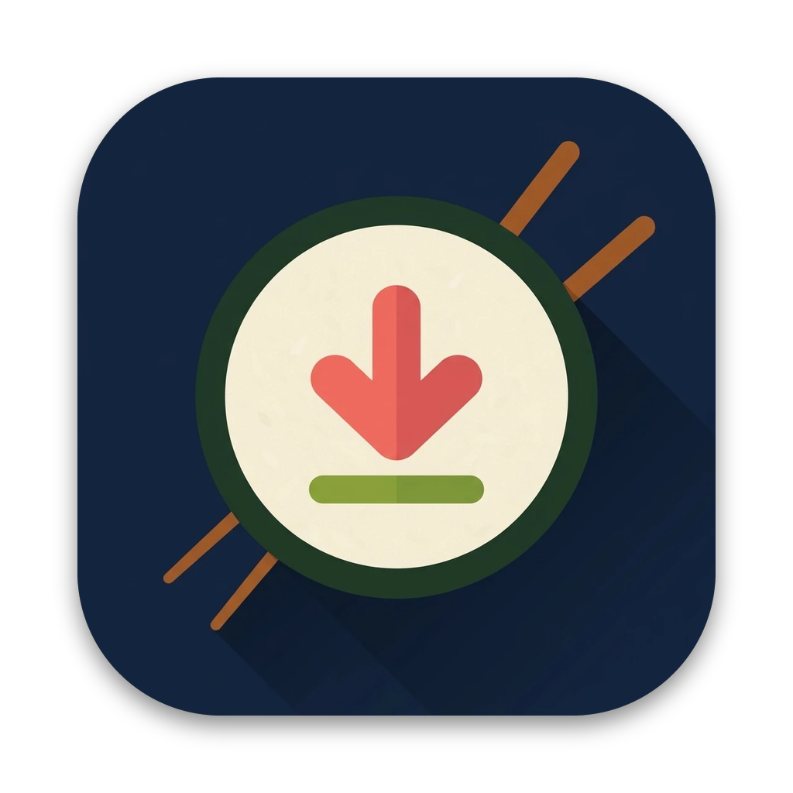
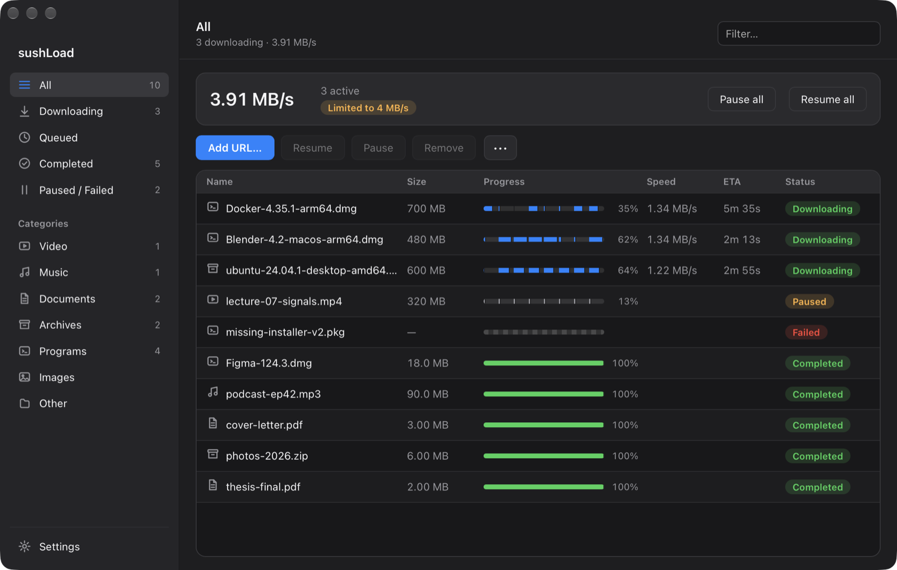
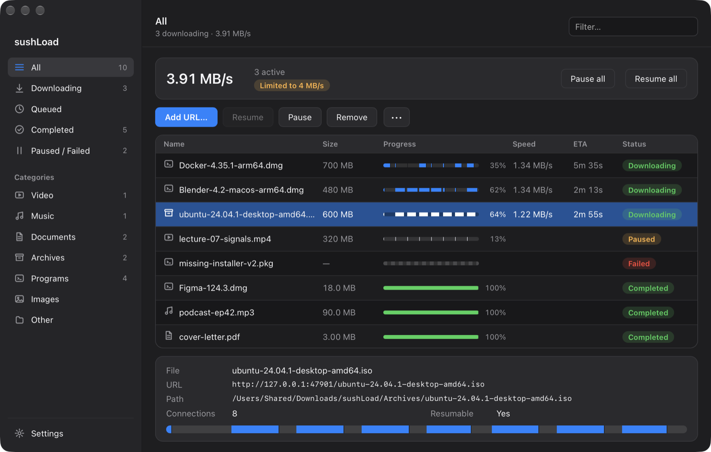
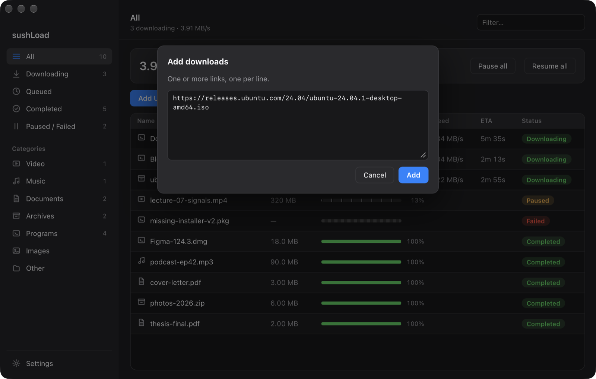
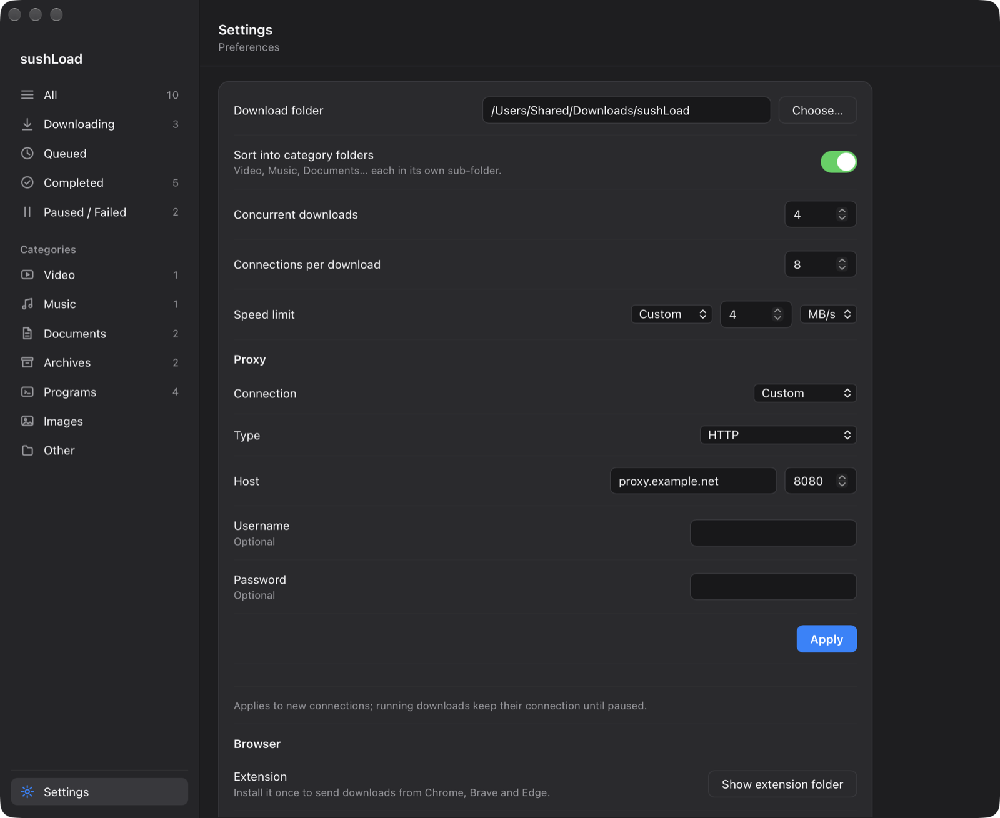
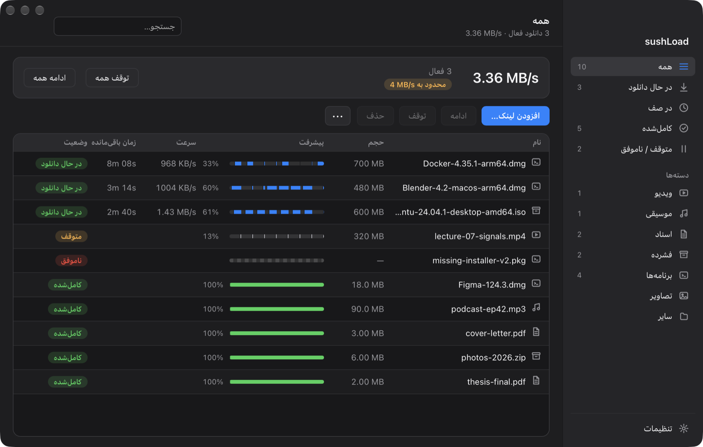

<p align="center"></p>

# sushLoad

A lightweight IDM-style download manager for macOS, written in Rust.

<p align="center"></p>

- Segmented downloads over HTTP(S) `Range` requests (1–16 connections), with dynamic splitting:
  a connection that finishes takes half of the largest remaining segment.
- Pause / resume that survives quitting, crashes and restarts (state in
  `~/Library/Application Support/sushLoad/state.json`, data in `<file>.part`).
- Queue (`max_concurrent`), global speed limit, retries with backoff, falls back to one
  connection when the server has no Range support.
- Category folders: `~/Downloads/sushLoad/{Video,Music,Documents,Archives,Programs,Images,Other}`,
  optionally split further by the site a file came from (see [Site folders](#site-folders)).
- Proxy: system proxy, none, or custom `http://`, `https://`, `socks5://`, `socks5h://` (with user/pass).
- English and Persian (RTL) UI.

## Screenshots

<table>
  <tr>
    <td width="50%"><br><sub>Detail drawer: URL, path, connections and the live per-segment bar.</sub></td>
    <td width="50%"><br><sub>Add one or many links (paste a URL and press Enter).</sub></td>
  </tr>
  <tr>
    <td width="50%"><br><sub>Settings: folders, queue, speed limit and proxy.</sub></td>
    <td width="50%"><br><sub>Persian (RTL) interface.</sub></td>
  </tr>
</table>

## Two ways to run

| | |
|---|---|
| **App** | `sushLoad.app`: native window (system WebKit view, not Electron), Dock icon, menus. Closing the window keeps downloads running. |
| **Browser** | `sushload --web` serves the same UI on `127.0.0.1` (token-protected) and opens it in your browser. `--no-open`, `--port N`. |

## Browser extension (Chrome, Brave, Edge)

Like IDM's integration module: it offers to take over downloads of chosen file types (hold
<kbd>Alt</kbd> while clicking to skip), adds "Download with sushLoad" / "Download all links" to the
context menu, and shows a "Download with sushLoad" pill over videos. Downloads are handed to the
app over native messaging together with the page's cookies, Referer and User-Agent, so links
that need a login work; cookies are only ever sent to the link's own site.

1. Install the app (`scripts/install.sh`); it registers the native messaging host.
2. Open `chrome://extensions`, turn on *Developer mode*, *Load unpacked*, and pick the
   `extension` folder (sushLoad › Settings › Browser › *Show extension folder*).

### Ask in the browser first

By default a download that matches the extension's file types goes straight to sushLoad, which
then asks for the name and folder. Turn on *Ask in the browser first* in the extension's options
to get Chrome's own prompt first (then sushLoad asks too).

## Download File Info

New downloads (from the browser, a pasted link or *Add URL…*) open a **Download File Info**
dialog: file name, category, size and whether the server supports resuming, and the folder it
will be saved to (including the site folders below). You can change the name, category and
folder, tick *Remember this folder* for that category, start now or choose *Download later*. A
file with the same name asks whether to rename or overwrite. Tick **Don't ask again** to start
downloads right away; Settings › *Ask before starting a download* turns the dialog back on.

## Site folders

Settings › *Site folders* (off by default) also splits the category folders by where a file came
from:

| Mode | Example |
|---|---|
| Off | `~/Downloads/sushLoad/Documents/lecture-03.pdf` |
| By site | `~/Downloads/sushLoad/Documents/sharif.edu/lecture-03.pdf` |
| By group and site | `~/Downloads/sushLoad/Documents/University/sharif.edu/lecture-03.pdf` |

- **Site** is the host of the page you were on (the Referer the extension sends), so files served
  from a CDN or storage host still land under the site; without a Referer it is the link's own
  host. It is reduced to the registrable domain (`www.` and ports dropped, `lms.cs.sharif.edu`
  becomes `sharif.edu`, `iust.ac.ir` and `bbc.co.uk` are kept whole); IP addresses and
  `localhost` stay as they are.
- **Group** is University, Government, Software, Cloud storage, Video, Music, News, Shopping,
  Social, Books & papers or Other. Order of precedence: your own choice in Settings › *Sites*,
  then built-in rules (`.edu`, `.ac.xx`, `.gov`, github.com, drive.google.com, youtube.com, …),
  then the optional on-device AI, else Other.
- The site folders go under the category folder, so *Sort into category folders* and the
  per-category folders you remembered still apply. A folder picked in the dialog wins over all of it.
- The **Sites** table in Settings lists every site seen so far with its group and folder name
  (both editable, with an *auto* / *you* / *AI* badge and a reset button). Changes apply to
  new downloads; files already saved stay where they are.

### On-device AI for unknown sites (optional)

With *By group and site*, a site the rules don't know can be grouped by Apple's on-device model
through the `tgsort-ai` helper (`~/.local/bin/tgsort-ai`, next to the app binary, or on `PATH`;
see *Use Apple Intelligence for unknown sites* in Settings, which is greyed out when the helper or
Apple Intelligence is missing). sushLoad gives it a tiny text describing the site (domain, the
page title the extension sent, the URL path without query, the file name), runs it in the
background, asks **once per site, ever**, and remembers the answer (or "unsure") in `state.json`.
Until it answers, that site's files go under *Other*. Nothing leaves the device; IPs and
`localhost` are never sent to it.

## Notifications

When a download finishes or fails, sushLoad shows a macOS notification (Settings › *Notify when
a download finishes*). Set `SUSHLOAD_NO_NOTIFY=1` to suppress the banner (tests, CI).

## Logging

sushLoad writes `~/Library/Logs/sushLoad/sushload.log` (Settings › *Open log folder*): one line
per event, rotated at 1 MiB into `sushload.log.1` .. `.3`. `SUSHLOAD_LOG=debug` (or `warn`,
`error`) changes the level; the default is `info`. URLs are redacted before they are logged
(credentials, query strings and fragments are dropped), cookies and proxy passwords are never
written, and page titles are cut to 80 characters.

## Build / install

```bash
scripts/bundle.sh    # dist/sushLoad.app + dist/sushLoad.dmg (ad-hoc signed)
scripts/install.sh   # copies to /Applications and links ~/.local/bin/sushload
cargo test --workspace
```

## Icon

`assets/logo.png` is the artwork; `scripts/make_icon.py` (needs Pillow) turns it into
`assets/AppIcon.png` / `AppIcon.icns` in the macOS rounded-square grid.

## Layout

- `core/` — engine (`engine/`), category rules, shared types (`model.rs`). No UI code.
- `app/` — local HTTP API + embedded web UI (`web/`), native window (`window.rs`).
